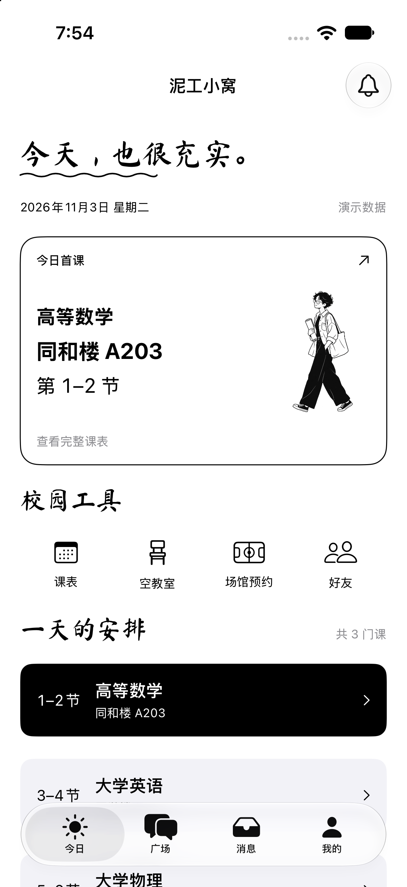
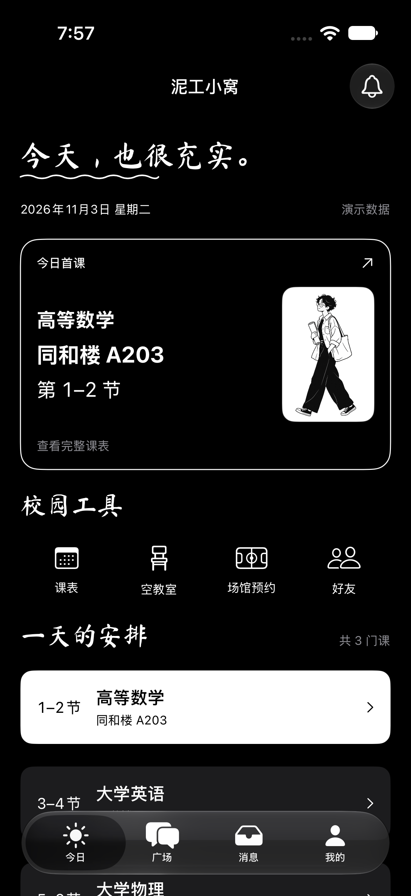
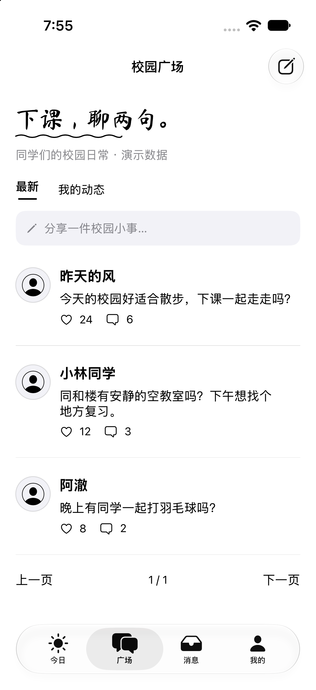
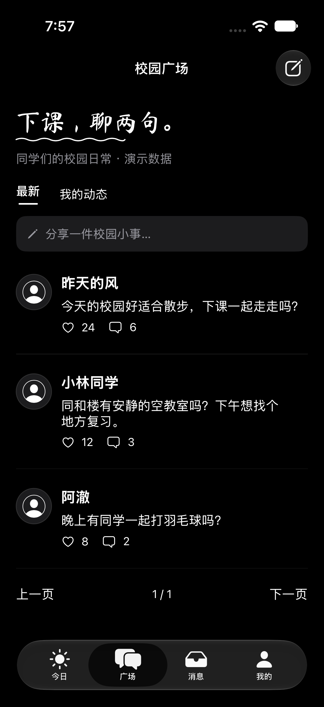
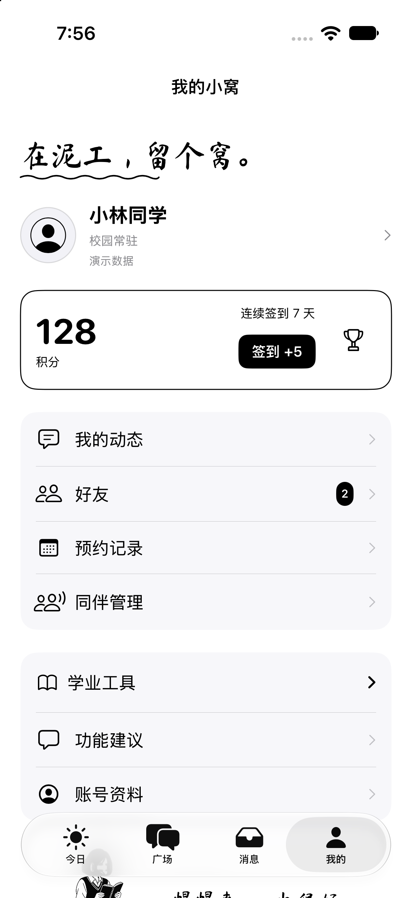
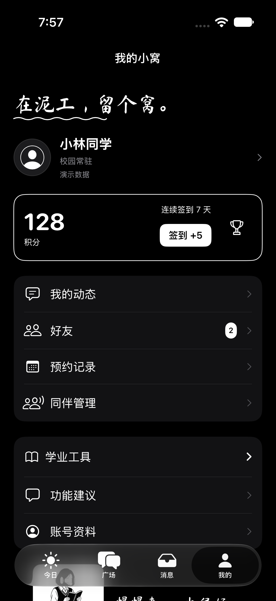

# 原生运行截图

截图来自实际编译运行的 SwiftUI 页面，使用本地演示数据。设备为 GitHub Actions 的 iPhone 17 / iOS 27.0 模拟器，工具链 Xcode 27.1，不是实体手机测试。

| 页面 | 浅色 | 深色 |
| --- | --- | --- |
| 今日 |  |  |
| 广场 |  |  |
| 我的 |  |  |

正常启动时的登录页：[production-login.png](production-login.png)。

最终代码验证入口：[GitHub Actions](https://github.com/ithtelab/nigo-nest-ios/actions/runs/41598472387)。改动审阅：[草稿 PR #1](https://github.com/2640322985/nigo-nest-ios/pull/1)。

主应用与小组件分别完成 Debug、Release 编译。截图经过空白检测并做人工视觉检查。截图不代表真实教务数据、场馆交易验证或自动交互测试通过；UI 自动化因云端 AX 初始化故障未能运行，详情见[实施说明](../black-white-campus.md)。
