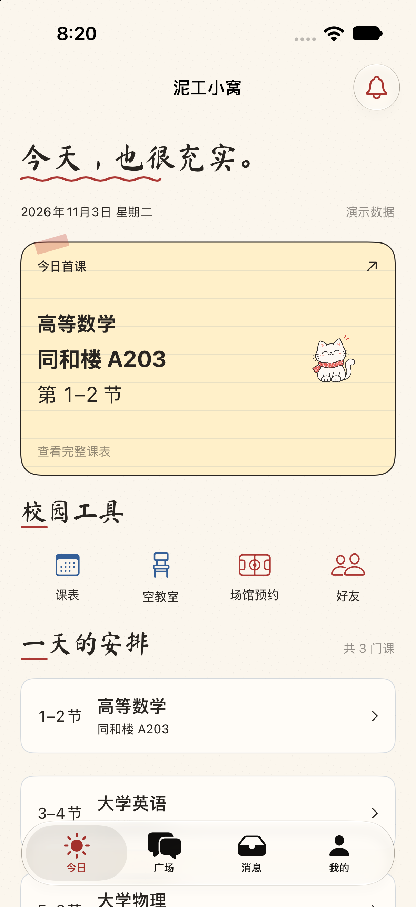
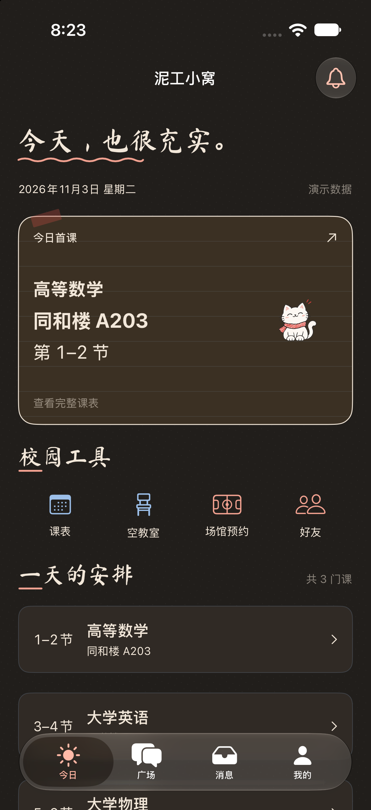
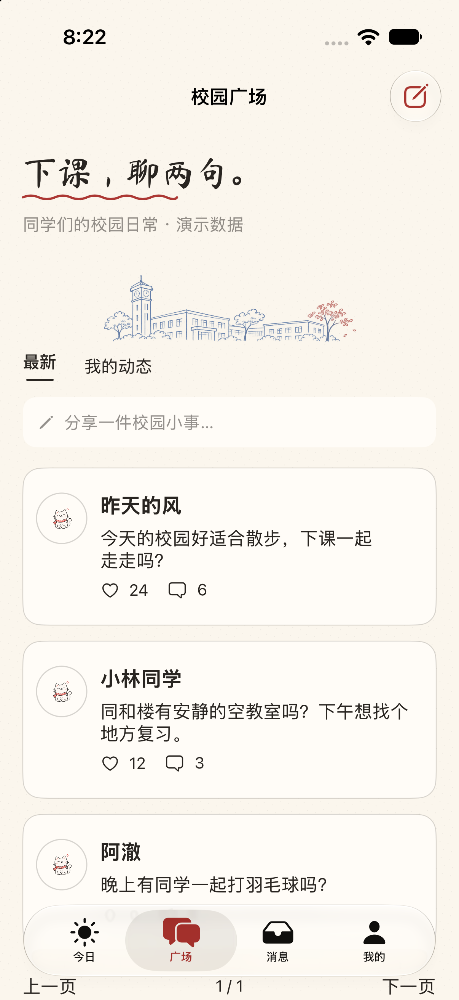
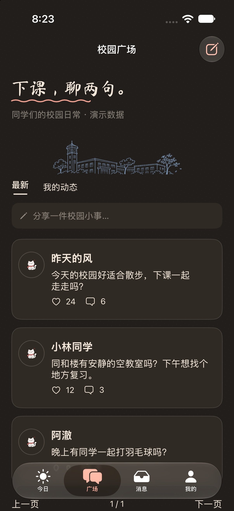
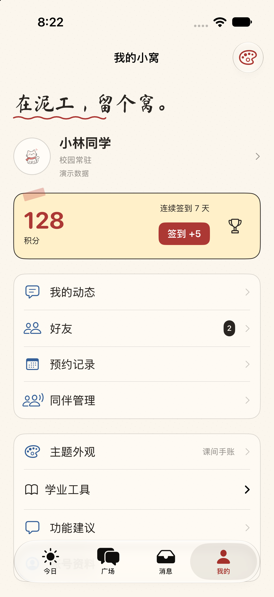
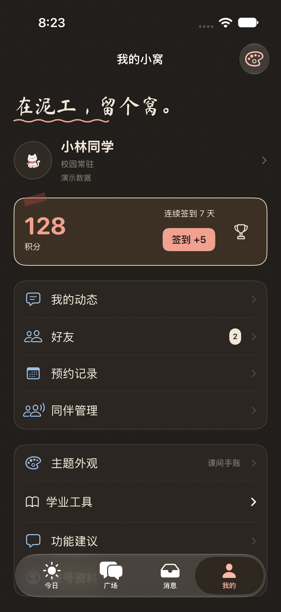
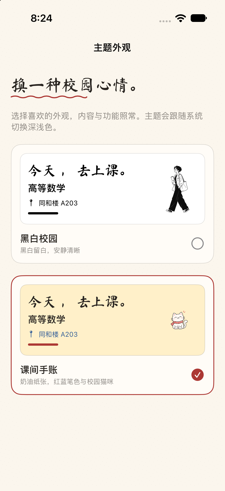
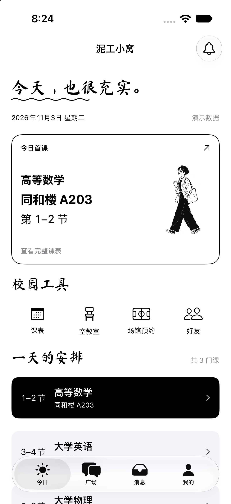
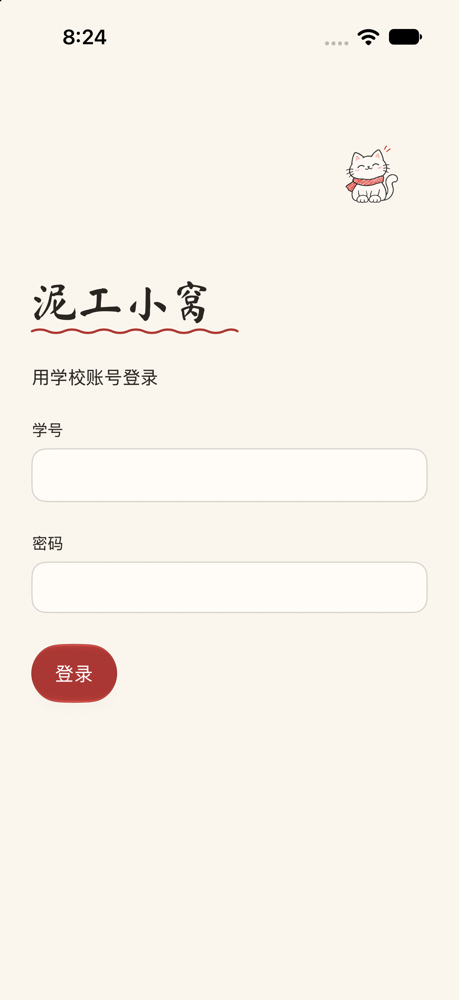

# 双主题实际运行截图

设备：GitHub Actions iPhone 17 / iOS 27.0 模拟器。工具链：Xcode 27.1。页面为实际编译运行的 SwiftUI 界面，使用本地演示数据。

| 页面 | 浅色 | 深色 |
| --- | --- | --- |
| 今日 |  |  |
| 广场 |  |  |
| 我的 |  |  |

| 主题选择 | 黑白主题回归 | 保留主题后的正常登录 |
| --- | --- | --- |
|  |  |  |

仅首次启动写入手账偏好，之后六次页面启动及正常登录不再覆盖偏好。黑白回归图使用 Debug 临时外观覆盖，不改已保存的手账选择。实际偏好读写、跨进程恢复、切回黑白、无效值回退由独立 Foundation 测试覆盖。

[验证运行](https://github.com/ithtelab/nigo-nest-ios/actions/runs/41601782830) · [功能与资源说明](../../themes.md)
